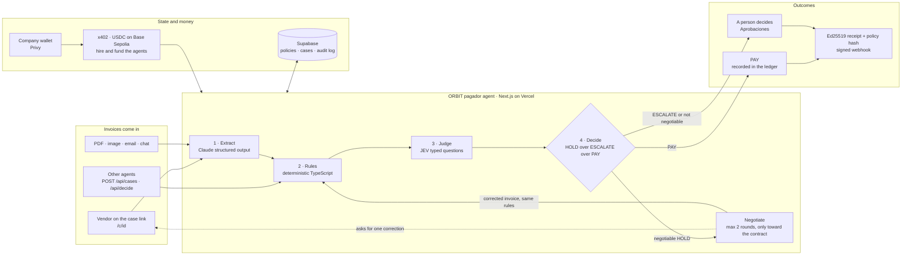

# ORBIT

**Actúa con autonomía. Nunca sin límites.**

> **ORBIT's agent pays your company's invoices only when they match your rules. When they don't, it negotiates the fix with the vendor and proves every decision with a signed receipt.**

## Why it matters

Companies want agents that pay vendors, but the blocker is **trust**: an agent that pays what it shouldn't, can't explain itself, or bends under pressure is worse than no agent. ORBIT keeps hard limits in code and uses AI only to read and to judge. Every payment can be audited after the fact.

- **Reads** invoices from any format (Claude).
- **Decides** PAY / HOLD / ESCALATE with deterministic rules plus fast typed judgments from JEV (TypeSafe), which can only tighten a decision, never loosen it.
- **Negotiates** with the vendor on a shareable link instead of just blocking. Corrections are rebuilt in code and re-checked by the same rules.
- **Proves** each decision with an Ed25519 receipt tied to the exact rule set, plus signed webhooks.
- **Gets hired** like an agent: the company activates and funds it in USDC over x402 from its Privy wallet.

## Results

**21/21** correct decisions · **0 unsafe payments**, before and after negotiation · **76%** decided with no human · **3 of 10** held invoices resolved with the vendor. See the [eval](docs/eval.md); JEV runs live in about 90 ms.

## Try it

- **Live:** https://orbit.devcristobalvc.com → *Iniciar sesión* (demo `123` / `123`) → workspace at `/app`. The pitch deck is at `/deck`.
- **Local:** `npm install && npm run dev`, then `npm test` (engine, negotiation, receipts and dataset eval).

## Docs

| | |
|---|---|
| [Architecture](docs/architecture.md) | Pipeline, safety invariant, negotiation, receipts, x402, code layout, real vs simulated |
| [API](docs/api.md) | Endpoints, guardrail usage, webhooks |
| [Setup](docs/setup.md) | Run, environment variables, database, deploy |
| [Dataset & eval](docs/dataset.md) | The fictitious company, the 21 invoices and how they are scored |
| [Pitch](docs/pitch.md) · [Changelog](CHANGELOG.md) · [Plan](todo.md) | Narrative, history and tasks |

**Stack:** Next.js 16 · TypeScript · Tailwind 4 · Claude (Anthropic SDK) · JEV (TypeSafe) · Supabase · Privy · x402 · Vercel.

Built during the **30X Hackathon** (Oct 16–18, 2026) for the **Blinka** challenge ("Agents that pay for the company") by Cristobal Valencia and wmb, working with AI coding agents.
